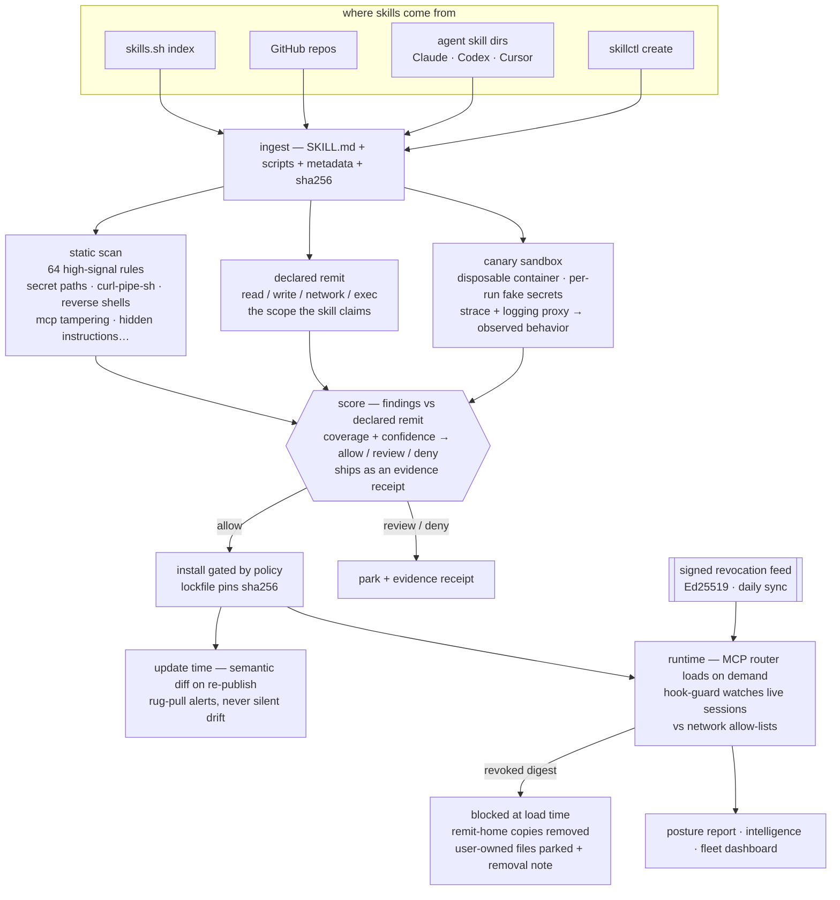

# remitlabs.github.io — the Remit landing

**Live:** https://remitlabs.github.io (GitHub Pages, auto-deploys from `main` on push, ~1 min)

Edit `index.html` (single file, no build step). Push → live.

Copy policy: **every claim must be runnable with the published CLI or backed by a measured number** from the machine that built the project (Oct 2026). Never claim a safety guarantee; the canary is evidence from one observed run, not proof.

## The pipeline (mermaid source — GitHub renders this)

### Status legend

| Stage | State (Oct 27, 2026) |
|---|---|
| ingest → static scan → canary → score | **shipped** (corpus-golden-tested in CI) |
| policy gate + locked installs | **shipped** for CLI and marketplace installs |
| lockfile + semantic-update diffs | shipped |
| MCP router + hook-guard | shipped (hook-guard observe-first) |
| signed feed + daily sync | shipped |
| canary containment | **open** — observer-first; egress enforcement only with an allowlist |
